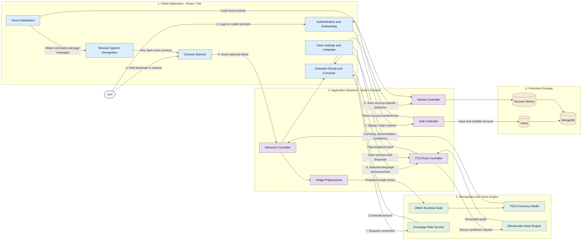
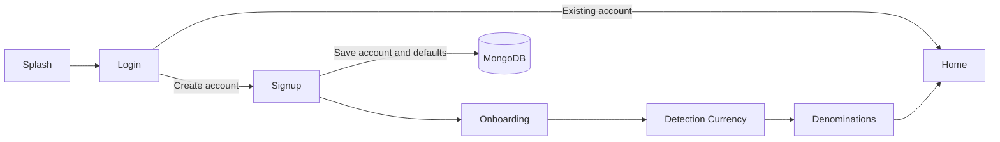
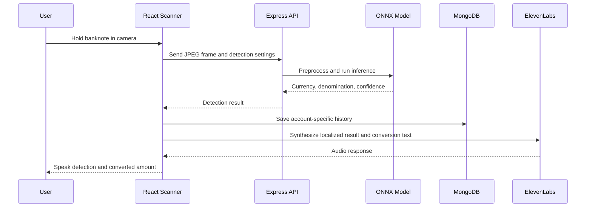

# DhanDrishti Architecture

## 7 Proposed System

### 7.1 Architectural Diagram



## Main Flows

### Account Flow



### Currency Detection Flow



## 7.3 Block Diagram

```mermaid
flowchart LR
    UI["USER INTERFACE\n• Login / Signup\n• Select language\n• View result\n• View history"]

    INPUT["CAMERA INPUT\nCapture banknote frame\nJPEG image"]

    PRE["IMAGE PREPROCESSING\nResize frame\nNormalize image\nPrepare tensor"]

    DETECT["CURRENCY DETECTION\nYOLO ONNX model\nONNX Runtime Node"]

    RESULT["RESULT PROCESSING\nCurrency\nDenomination\nConfidence score"]

    CONVERT["CONVERSION ENGINE\nLive exchange rate\nDefault target currency"]

    VOICE["VOICE OUTPUT\nLocalized announcement\nElevenLabs AI voice"]

    STORE["MONGODB STORAGE\nUsers\nAccount-specific history"]

    OUTPUT["APPLICATION OUTPUT\nSpoken result\nConverted value\nHistory record"]

    UI -->|Start scan| INPUT
    INPUT -->|Captured image| PRE
    PRE -->|Prepared frame| DETECT
    DETECT -->|Detected currency and confidence| RESULT
    RESULT -->|Detected amount| CONVERT
    CONVERT -->|Converted amount| VOICE
    RESULT -->|Save detection| STORE
    STORE -->|History data| OUTPUT
    VOICE -->|Audio response| OUTPUT
    OUTPUT -->|Display and speak| UI

    classDef ui fill:#dceefb,stroke:#5b7083,color:#111827;
    classDef input fill:#e2f1e4,stroke:#5c8061,color:#111827;
    classDef process fill:#eadcf1,stroke:#76527b,color:#111827;
    classDef output fill:#f5ead5,stroke:#967b4d,color:#111827;

    class UI,OUTPUT ui;
    class INPUT input;
    class PRE,DETECT,RESULT,CONVERT,VOICE process;
    class STORE output;
```



## Components

## 8.1 Techniques and Algorithms

- **YOLO currency detection:** identifies the currency class and denomination from a camera frame in a single inference pass.

- **ONNX Runtime inference:** executes the trained currency model through ONNX Runtime Node for fast server-side prediction.

- **Image preprocessing:** resizes camera frames to the model input size, removes alpha channels, converts pixels to RGB, and normalizes values to the range $0$ to $1$.

- **Confidence thresholding:** filters weak detections and classifies results as successful, low-confidence, wrong-currency, or error states.

- **Detection-mode filtering:** supports single-currency, multiple-selected-currency, and automatic all-currency detection modes.

- **Camera frame capture:** uses the browser MediaDevices API to capture live banknote images from the device camera.

- **Multilingual text generation:** creates localized result, conversion, onboarding, scanner, and counterfeit announcements for the selected language.

- **ElevenLabs neural text-to-speech:** converts localized text into natural audio using the configured ElevenLabs voice ID and language code.

- **Continuous speech recognition:** uses browser SpeechRecognition with automatic session restart to recognize commands such as “Hey, open scan currency.”

- **Currency conversion:** calculates the converted value using live exchange rates and falls back to stored indicative rates when the network is unavailable.

- **Counterfeit verdict classification:** evaluates security checks and combines their results into authentic, suspicious, or counterfeit verdicts.

- **Password hashing:** protects account passwords with salted Node.js `scrypt` hashing and constant-time comparison during login.

- **Account-specific persistence:** stores users and detection history in MongoDB using the authenticated user’s normalized email as the account boundary.

- **History upsert and filtering:** saves each detection with an identifier, currency, denomination, confidence, source, timestamp, and optional counterfeit verdict.

## 7.4 Proposed System Comparison

| Aspect | Existing system | DhanDrishti proposed system |
|---|---|---|
| Currency detection | Manual identification or separate currency applications | Camera-based YOLO ONNX model identifies currency, denomination, and confidence |
| User access | Generic interfaces that may not support low-vision users | Accessibility-first React interface with large controls, voice output, and simple navigation |
| Setup | Separate tools for detection, conversion, and speech | One integrated web application for scanning, conversion, voice, history, and settings |
| Speech feedback | Often limited to a default device voice or text-only results | ElevenLabs AI voice with localized announcements in Kannada, Hindi, Telugu, Tamil, Malayalam, Marathi, and English |
| Language support | Language selection may not affect every system message | Selected language is used for onboarding, scanning, detection, conversion, and counterfeit announcements |
| Currency conversion | Manual calculation or separate converter | Automatic conversion immediately after detection using live exchange rates and a saved default target currency |
| Counterfeit checking | Requires a separate security-check process | Integrated AI security-feature analysis classifies notes as authentic, suspicious, or counterfeit |
| User accounts | Demo or device-only preferences | MongoDB-backed signup, login, profile details, and saved user preferences |
| History | Shared, mock, or browser-only records | Account-specific MongoDB history for camera detections and counterfeit checks |
| Voice navigation | Manual screen navigation | Continuous browser speech recognition supports commands such as “Hey, open scan currency” |
| Deployment | Multiple disconnected services and tools | React/Vite frontend with a Node/Express API and secure ElevenLabs proxy |
| Target users | General currency users | Visually impaired users who need independent, spoken currency recognition |

- **React/Vite client:** authentication screens, onboarding, scanner, result, converter, history, settings, and profile.
- **Camera capture:** browser `getUserMedia` provides frames to the scanner.
- **Speech commands:** browser speech recognition listens continuously on Home for the scan command.
- **Express API:** owns authentication, inference, MongoDB history, and the ElevenLabs proxy.
- **ONNX Runtime Node:** runs `public/model.onnx` against camera frames.
- **MongoDB:** stores users and account-specific history records.
- **ElevenLabs:** the only speech synthesis provider. API credentials remain server-side.
- **Exchange Rate API:** supplies live conversion rates with offline indicative-rate fallback.

## Local Development

Run the API and frontend in separate terminals:

```powershell
cd Currency_Vision
npm run api
```

```powershell
cd Frontend
npm run dev
```

The Vite development server proxies `/api` requests to `http://localhost:8787`.
